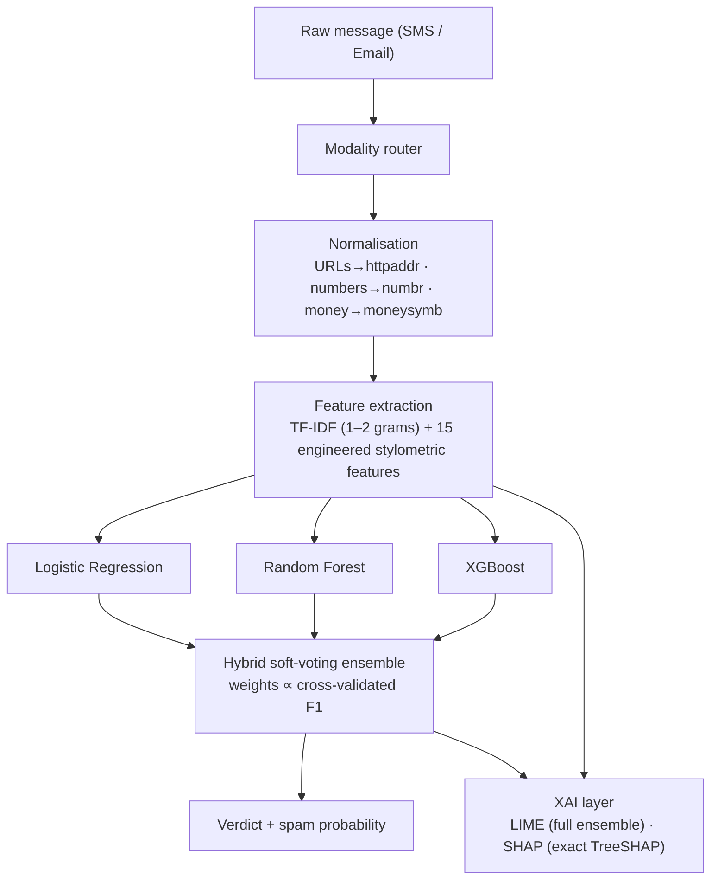

# An Interpretable Multi-Modal Spam Detection Framework Using Explainable AI and Machine Learning

A research project that detects scam **SMS** and **Email** messages with a hybrid ensemble of
classical ML models — **Logistic Regression + Random Forest + XGBoost** combined by
performance-weighted soft voting — and explains **every prediction** with **SHAP** and **LIME**.
Ships with a fully interactive Streamlit demo.

> **Verticals:** Machine Learning · **Type:** Research · **Level:** Intermediate · **Language:** Python

---

## Results at a glance

| Modality | Dataset | Best system | Accuracy | Precision | Recall | F1 | ROC-AUC |
|---|---|---|---|---|---|---|---|
| SMS | UCI SMS Spam Collection (5,158) | Hybrid Ensemble | **98.55%** | 0.9669 | 0.9141 | 0.9398 | 0.9941 |
| Email | Enron-Spam (12,000) | Hybrid Ensemble | **98.25%** | 0.9705 | 0.9940 | 0.9821 | **0.9983** |

Full per-model tables: [reports/results.md](reports/results.md) · machine-readable: [reports/metrics.json](reports/metrics.json)

The ensemble never loses to its base learners on ROC-AUC and wins outright on Email. Beyond the
numbers, the XAI layer shows *why* each verdict was reached — and even surfaced a real dataset
bias (the token `enron` acting as a "ham" shortcut in the Enron corpus), something accuracy
tables can never reveal.

## The demo

```bash
streamlit run app.py        # then open http://localhost:8501
```

Four tabs:

1. **🔍 Detector** — paste any message (or pick a real held-out example). You get the verdict with
   the ensemble spam probability, each base model's vote with its weight, the message with
   **LIME-highlighted words** (red pushes spam, blue pushes ham), a **SHAP waterfall**, and the
   engineered stylometric features.
2. **📊 Model performance** — metrics tables, model-comparison dot plots, ROC curves, confusion
   matrices for both modalities.
3. **🧠 Global explanations** — SHAP beeswarm + importance plots: what the models actually learned.
4. **ℹ️ About** — architecture diagram, methodology, references.

## Quickstart (from scratch)

```bash
# 1. environment (Python 3.10–3.12 recommended)
python -m venv .venv && source .venv/bin/activate
pip install -r requirements.txt

# 2. data + training + evaluation + figures (~2 min; downloads two public corpora on first run)
python -m src.data_loader
python -m src.train

# 3. verify everything end-to-end (pipeline, SHAP, LIME, simulated app session)
python tests/smoke_test.py

# 4. launch the demo
streamlit run app.py
```

The executed research notebook (EDA → methodology → results → XAI analysis) is at
[notebooks/spam_detection_research.ipynb](notebooks/spam_detection_research.ipynb).

## Architecture



**Multi-modal by design** — SMS and e-mail differ radically (median 11 vs ~160 words; 12% vs 48%
spam), so each modality gets its own feature space and its own trained ensemble; a lightweight
router (length/structure heuristic, user-overridable in the app) picks the specialist at
inference time.

### Features (interpretability-first)

* **TF-IDF** (uni+bi-grams, sublinear TF) over *normalised* text: instead of deleting URLs,
  numbers, money and phone numbers, they become readable tokens — `httpaddr`, `numbr`,
  `moneysymb`, `phonenumbr` — that appear verbatim in explanations.
* **15 engineered statistics** computed on the raw message (UPPER-CASE names so they are
  visually distinct in SHAP plots): `DIGIT_RATIO`, `UPPERCASE_RATIO`, `NUM_EXCLAMATIONS`,
  `NUM_URLS`, `NUM_PHONES`, `SPAM_KEYWORDS` (transparent lexicon in `src/config.py`), etc.
* No stemming — surface forms keep every explanation human-readable.

### Models & ensemble

Three heterogeneous learners (linear / bagging / boosting) with imbalance handling
(`class_weight='balanced'`, `scale_pos_weight`). The hybrid ensemble computes
`p(spam|x) = Σ w_m · p_m(spam|x)` with `w_m ∝` each model's 5-fold cross-validated F1 —
a stronger learner gets a proportionally louder vote.

### Explainability (XAI)

| Technique | Explains | Scope | How |
|---|---|---|---|
| **LIME** | the **full hybrid ensemble** | local (per message) | ~1,000 word-dropout perturbations re-scored through the whole pipeline → local linear surrogate → signed per-word weights |
| **SHAP** (TreeExplainer) | the XGBoost component | local (waterfall) + global (beeswarm, importance) | exact additive log-odds attributions over all 3,015/5,015 features |

Key global finding: stylometry rivals vocabulary — `DIGIT_RATIO`, `AVG_WORD_LEN` and
`SPAM_KEYWORDS` top the SHAP ranking on SMS. A scam is betrayed by its *shape*, not just its words.

## Project structure

```
├── app.py                     # Streamlit demo (4 tabs)
├── requirements.txt
├── src/
│   ├── config.py              # paths, hyper-parameters, keyword lexicon
│   ├── data_loader.py         # dataset download (with mirror fallbacks) + cleaning
│   ├── preprocessing.py       # normalisation → readable placeholder tokens
│   ├── features.py            # TF-IDF + 15 engineered features (SpamFeaturizer)
│   ├── models.py              # base learners, HybridVotingEnsemble, SpamDetector bundle
│   ├── explain.py             # LIME + SHAP helpers
│   ├── plotting.py            # shared publication style (validated palette)
│   └── train.py               # full pipeline: CV, fit, evaluate, figures, artefacts
├── tests/smoke_test.py        # end-to-end checks incl. simulated Streamlit session
├── notebooks/spam_detection_research.ipynb   # executed research walkthrough
├── data/processed/            # sms.csv, email.csv (built by data_loader)
├── models/                    # {sms,email}_detector.joblib
└── reports/                   # metrics.json, results.md, examples.json, figures/*.png
```

## Datasets

| Corpus | Size used | Notes |
|---|---|---|
| [UCI SMS Spam Collection](https://archive.ics.uci.edu/dataset/228/sms+spam+collection) | 5,158 (after dedup) | Almeida & Gómez Hidalgo, 2011 |
| [Enron-Spam](http://nlp.cs.aueb.gr/software_and_datasets/Enron-Spam/) | 12,000 stratified subsample of ~33k | Metsis et al., 2006; fetched via consolidated CSV mirror, SpamAssassin corpus as fallback |

`python -m src.data_loader --force` rebuilds from scratch; set `EMAIL_SAMPLE_SIZE = None` in
`src/config.py` to train on the full Enron corpus.

## Limitations

English-only corpora from 2002–2012; the `enron`-token bias shows the e-mail model partly fits
its domain, so cross-domain evaluation is future work; SHAP covers the boosted-tree component
while LIME covers the full ensemble. **Research & education use only — not a production filter.**

## References

1. Almeida, T.A., Gómez Hidalgo, J.M. (2011). *SMS Spam Collection v.1*. UCI ML Repository.
2. Metsis, V., Androutsopoulos, I., Paliouras, G. (2006). *Spam Filtering with Naive Bayes — Which Naive Bayes?* CEAS.
3. Ribeiro, M.T., Singh, S., Guestrin, C. (2016). *"Why Should I Trust You?" Explaining the Predictions of Any Classifier* (LIME). KDD.
4. Lundberg, S.M., Lee, S.-I. (2017). *A Unified Approach to Interpreting Model Predictions* (SHAP). NeurIPS.
5. Chen, T., Guestrin, C. (2016). *XGBoost: A Scalable Tree Boosting System*. KDD.
6. Pedregosa, F. et al. (2011). *Scikit-learn: Machine Learning in Python*. JMLR 12.
